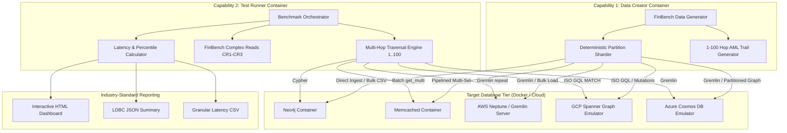

# LDBC FinBench Multi-Engine Graph Benchmark Suite

Comprehensive, cloud-native benchmark suite implementing the official **[LDBC Financial Benchmark (FinBench) Specification](https://ldbcouncil.org/ldbc_finbench_docs/ldbc-finbench-specification.pdf)**.

Designed to benchmark multi-hop read traversals (**1 hop, 2 hops, ... up to 100 hops**) and transactional risk patterns across:
1. **Neo4j** (Native Graph DBMS with Cypher)
2. **Memcached** (Ultra-high-throughput In-Memory Graph Adjacency Cache)
3. **AWS Neptune** (Managed Cloud Graph with Apache TinkerPop Gremlin)
4. **GCP Spanner GraphDB** (Globally Distributed Relational Graph with ISO GQL)
5. **Azure Cosmos DB** (Multi-Model Globally Distributed Graph with Gremlin API)

---

## 1. System Architecture

The benchmark is decomposed into modular **containerized capabilities**:



---

## 2. LDBC FinBench Schema Mapping

The benchmark faithfully implements the vertices and multi-edges of the LDBC FinBench specification:

### Vertices (Nodes)
* **`Person`**: `id`, `name`, `isBlocked`, `createTime`, `gender`, `birthday`, `country`, `city`
* **`Account`**: `id`, `createTime`, `isBlocked`, `type`, `nickname`, `phonenum`, `freqLoginType`, `lastLoginTime`, `accountLevel`
* **`Company`**: `id`, `name`, `isBlocked`, `createTime`, `country`, `city`, `business`, `description`
* **`Loan`**: `id`, `loanAmount`, `balance`, `createTime`, `usage`, `interestRate`
* **`Medium`**: `id`, `medType`, `isBlocked`, `createTime`, `lastLogin`

### Edges (Relationships & Activities with Multiplicity)
* **`transfer`**: `Account` $\to$ `Account` (`amount`, `createTime`, `order`) &mdash; supports edge multiplicity
* **`withdraw`**: `Account` $\to$ `Account` / `Loan` (`amount`, `createTime`)
* **`repay`**: `Account` $\to$ `Loan` (`amount`, `createTime`)
* **`deposit`**: `Loan` $\to$ `Account` (`amount`, `createTime`)
* **`signIn`**: `Medium` $\to$ `Account` (`createTime`)
* **`own`**: `Person` / `Company` $\to$ `Account` (`createTime`)
* **`apply`**: `Person` / `Company` $\to$ `Loan` (`createTime`, `organization`)
* **`guarantee`**: `Person` $\to$ `Person`, `Company` $\to$ `Company` (`createTime`, `relation`)
* **`invest`**: `Person` / `Company` $\to$ `Company` (`createTime`, `ratio`)
* **`workIn`**: `Person` $\to$ `Company` (`createTime`, `comment`)

Schema DDL scripts are provided in `schemas/`:
* [schemas/neo4j/schema.cypher](file:///Users/gsswain/ai-code/code/graph-db-benchmark/schemas/neo4j/schema.cypher)
* [schemas/memcached/schema_design.md](file:///Users/gsswain/ai-code/code/graph-db-benchmark/schemas/memcached/schema_design.md)
* [schemas/neptune/schema.gremlin](file:///Users/gsswain/ai-code/code/graph-db-benchmark/schemas/neptune/schema.gremlin)
* [schemas/spanner/schema.sql](file:///Users/gsswain/ai-code/code/graph-db-benchmark/schemas/spanner/schema.sql) & [schemas/spanner/graph_definition.sql](file:///Users/gsswain/ai-code/code/graph-db-benchmark/schemas/spanner/graph_definition.sql)
* [schemas/cosmos/schema.gremlin](file:///Users/gsswain/ai-code/code/graph-db-benchmark/schemas/cosmos/schema.gremlin)

---

## 3. Scale Architecture: 100M Users, 10B Accounts, 10T Transactions

Generating and evaluating **10 Trillion transactions** (~500 TB to 1 PB raw graph data) requires a distributed architecture:

### Scale Presets

| Preset | Users (Person) | Accounts | Transactions (Transfer) | Mode / Environment |
| :--- | :--- | :--- | :--- | :--- |
| **`dev`** | 1,000 | 5,000 | 25,000 | Instant local test / CI (<1s) |
| **`local`** | 10,000 | 50,000 | 250,000 | Local Docker container benchmark |
| **`medium`** | 100,000 | 1,000,000 | 10,000,000 | Medium cluster evaluation |
| **`cloud`** | 1,000,000 | 100,000,000 | 1,000,000,000 | Cloud distributed test |
| **`full`** | **100,000,000** | **10,000,000,000** | **10,000,000,000,000** | Full 10-Trillion distributed shards |

### Deterministic Sharding & Distributed Execution
Each worker node runs `generator.py` with `--partitions <N> --partition-id <I>`:
* PRNG state is seeded deterministically: `seed + partition_id * 10007`.
* Partitions generate contiguous, non-overlapping slices of the vertex space.
* Degree distributions follow Zipfian power laws ($P(k) \propto k^{-\alpha}$, $\alpha \approx 1.3$) modeling financial hub accounts.
* Shards stream directly into cloud storage (S3 / GCS / Azure Blob) in database bulk-loader formats.

---

## 4. Multi-Hop Read Traversal (1 to 100 Hops)

In financial transaction networks, tracking multi-hop fund dispersion ($A_0 \to A_1 \to \dots \to A_k$) is critical for detecting layering, money laundering rings, and fraud networks.

### Traversal Modes
1. **`path_trace`** (Default): Directed path traversal following chronological, decreasing-amount money transfers from depth 1 to depth 100.
2. **`reachability`**: Tests whether source account $A$ reaches target account $B$ in exactly $k$ hops.
3. **`frontier_bfs`**: Bounded beam BFS expanding the top-$B$ highest-value transfers per hop up to depth $k$.
4. **`shortest_path`**: Shortest transfer path between distant accounts bounded by depth $k$.

### Multi-Query-Language Testing Matrix
When a database supports multiple query languages or execution paradigms, this benchmark suite tests and evaluates each language independently to analyze performance differences:

| Database Engine | Query Paradigm Alias | Query Language / Strategy | Implementation Details |
| :--- | :--- | :--- | :--- |
| **Neo4j** | `neo4j-cypher` | Declarative Cypher | `MATCH (a:Account {id: $start_id})-[:transfer*$depth]->(b:Account) RETURN b.id LIMIT 10` |
| **Neo4j** | `neo4j-trail` | Directed Trail Reachability | `MATCH p = (a:Account {id: $start_id})-[:transfer*$depth]->(b:Account {id: $target_id}) RETURN length(p) LIMIT 1` |
| **Memcached** | `memcached-multiget` | Pipelined BFS Multi-Get | Bounded-beam frontier batching via `client.get_many(keys)` |
| **Memcached** | `memcached-dfs` | Single-Key Recursive DFS | Sequential pointer-chasing O(N) trail retrieval via single `client.get(key)` |
| **AWS Neptune** | `neptune-gremlin` | Apache TinkerPop Gremlin | Bytecode traversal `g.V().has('Account', 'id', start_id).repeat(out('transfer')).times(depth).limit(10)` |
| **AWS Neptune** | `neptune-opencypher` | openCypher HTTP API | AWS Neptune openCypher endpoint `POST /openCypher` |
| **AWS Neptune** | `neptune-sparql` | W3C RDF SPARQL | SPARQL 1.1 property path `PREFIX : <http://finbench/> SELECT ?dst WHERE { :Account (:transfer){depth} ?dst }` |
| **GCP Spanner** | `spanner-gql` | ISO GQL (Property Graph) | `GRAPH FinBenchGraph MATCH (a:Account WHERE a.id = @start_id)-[e:transfer]->{depth}(b:Account) RETURN b.id LIMIT 10` |
| **GCP Spanner** | `spanner-sql` | Relational Chained Joins | GoogleSQL relational self-joins `FROM Transfer t1 JOIN Transfer t2 ON t1.toId = t2.fromId ... WHERE t1.fromId = @start_id` |
| **Azure Cosmos DB**| `cosmos-gremlin` | Gremlin Graph API | Azure Cosmos DB Graph Gremlin endpoint `ws://cosmos:8182/gremlin` |
| **Azure Cosmos DB**| `cosmos-sql` | NoSQL / Document SQL | Azure Cosmos SQL API partitioned by `/pk` |

### Engine Implementations

* **Neo4j (Cypher)**:
  ```cypher
  MATCH (a:Account {id: $start_id})-[:transfer*$depth]->(b:Account)
  RETURN b.id AS target_id LIMIT 10
  ```
* **Memcached (Pipelined BFS Multi-Get)**:
  ```python
  # Hop k expansion over in-memory adjacency list
  batch_keys = [f"adj:out:Account:{aid}:transfer" for aid in frontier]
  raw_results = memcached_client.get_many(batch_keys)
  ```
* **AWS Neptune (Gremlin)**:
  ```groovy
  g.V().has(Account, id, start_id)
   .repeat(out(transfer)).times(depth)
   .limit(10).id()
  ```
* **GCP Spanner Graph (ISO GQL)**:
  ```sql
  GRAPH FinBenchGraph
  MATCH (a:Account WHERE a.id = @start_id)-[e:transfer]->{depth}(b:Account)
  RETURN b.id LIMIT 10
  ```

---

## 5. Quickstart: Local Docker Run

### Prerequisites
* Docker & Docker Compose (v2.20+)
* Python 3.9+ (optional for local host runner)

### One-Command Quickstart
```bash
./scripts/quickstart.sh
```
This script automatically:
1. Starts **Neo4j** and **Memcached** containers with tuned memory parameters.
2. Applies the LDBC FinBench schema and constraints.
3. Generates synthetic data with ground-truth 100-hop AML trails.
4. Executes multi-hop read benchmarks across **1, 2, 3, 4, 5, 6, 7, 8, 9, 10, 15, 20, 30, 40, 50, 75, 100 hops**.
5. Generates the performance, cost, and modeling HTML pages in `docs/`; JSON summaries and the CSV log remain in `reports/`.

---

## 6. Manual Execution & Capabilities

### Step 1: Start Database Containers
```bash
# Start Neo4j and Memcached
docker compose up -d neo4j memcached

# Or start all 4 local containers (including Neptune Gremlin and Spanner emulator)
docker compose --profile all up -d
```

### Step 2: Generate Schema & Data
```bash
# Generate dev dataset (runs in ~1s)
docker compose run --rm data-generator --preset dev --target neo4j,memcached

# Or generate 100,000 accounts with 100-hop ground truth trails
docker compose run --rm data-generator --preset local --target neo4j,memcached --deep-hops 100 --chains 20
```

### Step 3: Run the Benchmark Runner
```bash
# Benchmark from 1 to 100 hops
docker compose run --rm test-runner --engines neo4j,memcached --hops 1,2,3,4,5,10,20,50,100 --iterations 10

# Or benchmark arbitrary hop range with step 1
docker compose run --rm test-runner --engines neo4j,memcached --hop-range 1 100 --hop-step 5 --iterations 10
```

---

## 7. Industry-Standard Benchmark Reporting

The test runner outputs:
1. **Interactive HTML Dashboard** (`docs/benchmark_report.html`):
  * Performance-only page with responsive **Chart.js** visualizations and links to the cost and modeling reports.
   * **Hop Depth vs. Median Latency (p50)** curve comparing all engines from 1 to 100 hops.
   * **Throughput (QPS)** scaling across hop depths.
   * **Tail Latency Comparison** (p50 vs p90 vs p99).
  * Full performance statistics table.
2. **Database Cost Report** (`docs/cost_report.html`):
  * Separate monthly infrastructure, license, and cost-per-query estimates, with a link back to the benchmark.
3. **Modeling & Data Storage Report** (`docs/modeling_report.html`):
  * Compares each engine's logical graph model, physical representation, traversal behavior, and schema design implications.
4. **JSON Summaries** (`reports/benchmark_summary.json`, `reports/cost_summary.json`):
   * Machine-readable format conforming to LDBC benchmark reporting standards.
5. **CSV Latency Trace** (`reports/benchmark_summary.csv`):
   * Granular latency measurements per engine and hop depth.
6. **Terminal Markdown Table**: Real-time console progress and summary.

GitHub Pages publishes the `docs/` directory. The site landing page is [docs/index.html](docs/index.html); enable **Settings → Pages → Build and deployment → GitHub Actions** once for the repository. The workflow deploys on pushes to `main` or `master` when `docs/` changes, or manually through the Actions tab.

---

## 8. Database Infrastructure Cost Estimation (DB Only)

To evaluate the operational total cost of ownership (TCO) across different database engines and scales, the benchmark suite includes a dedicated **Database Infrastructure Cost Estimator** ([scripts/cost_estimator.py](file:///Users/gsswain/ai-code/code/graph-db-benchmark/scripts/cost_estimator.py) and [test-runner/reporting/cost_estimator.py](file:///Users/gsswain/ai-code/code/graph-db-benchmark/test-runner/reporting/cost_estimator.py)).

> [!NOTE]
> This estimation accounts for **dedicated database infrastructure** (compute instances, RAM page caches, Spanner nodes, Cosmos RU/s, cluster storage, and I/O charges). It excludes client/test-runner VM compute. Neo4j is modeled as a three-node self-hosted Enterprise HA cluster. Its infrastructure is included, but its commercial license is quote-based and is reported as unpriced unless you supply your per-core monthly quote.

### Pricing Reference Models (US Cloud Rates)

| Database Engine | Pricing Model | Compute Unit Rate | Storage Rate | I/O / Request Rate |
| :--- | :--- | :--- | :--- | :--- |
| **Neo4j** | Self-hosted Enterprise, 3-node HA | $0.09 / GB RAM-hr per node | $0.15 / GB-month per node | Enterprise license: quote-based, per core |
| **Memcached** | AWS ElastiCache (`cache.r6g`) | $0.015 / GB RAM-hr | In-Memory (No disk) | Included (Network) |
| **AWS Neptune** | Multi-AZ Cluster (`db.r6g`) | $0.06 / GB RAM-hr | $0.10 / GB-month | $0.20 / 1M I/O requests |
| **GCP Spanner** | Cloud Spanner (Graph & SQL) | $0.90 / node-hr (1,000 PUs) | $0.30 / GB-month (SSD) | Included in Node PUs |
| **Azure Cosmos DB**| Gremlin & NoSQL API | $0.008 / 100 RU/s-hr | $0.25 / GB-month | Billed via RU consumption |

---

### Monthly Infrastructure Cost Matrix by Scale Preset

The table below details monthly infrastructure sizing and costs required to sustain a baseline workload of **1,000 read QPS** across each scale preset:

| Scale Preset | Persons / Accounts / Transfers | Neo4j | Memcached | AWS Neptune | GCP Spanner | Azure Cosmos DB |
| :--- | :--- | :--- | :--- | :--- | :--- | :--- |
| **`dev`** | 1K / 5K / 25K (~0.01 GB) | $131.55/mo | **$10.95/mo** | $1,226.50/mo | $657.30/mo | $876.25/mo |
| **`local`** | 10K / 50K / 250K (~0.1 GB) | $131.55/mo | **$10.95/mo** | $1,226.50/mo | $657.30/mo | $876.25/mo |
| **`medium`** | 100K / 1M / 10M (~5.0 GB) | $247.50/mo | **$65.70/mo** | $1,227.20/mo | $659.10/mo | $877.88/mo |
| **`cloud`** | 1M / 100M / 1B (~500 GB) | $24,750/mo | $6,570/mo | $14,271/mo | **$867.00/mo** | $1,063.50/mo |
| **`full`** | **100M / 10B / 10T (~500 TB)** | $24,750,000/mo | $6,570,000/mo | $13,221,050/mo | **$439,950/mo** | **$188,376/mo** |

---

### Cost Efficiency per Workload: Cost per 1 Million Traversal Queries ($/1M Ops)

Measured cost efficiency derived from real multi-hop traversal executions:

| Query Paradigm | 1 Hop | 5 Hops | 10 Hops | 50 Hops | 100 Hops | Architectural Cost Driver |
| :--- | :--- | :--- | :--- | :--- | :--- | :--- |
| **Memcached-DFS** | **$0.001** | **$0.001** | **$0.001** | **$0.006** | **$0.013** | O(N) single-get pointer chasing in pure memory hash tables |
| **Memcached-MultiGet** | **$0.001** | **$0.001** | $0.006 | $0.059 | $0.058 | Pipelined batch multi-gets over high-bandwidth cache tier |
| **Neo4j-DirectedTrail** | $0.043 | $0.059 | $0.068 | $0.063 | $0.109 | Bounded-endpoint bidirectional graph index pruning |
| **Neo4j-Cypher** | $0.074 | $0.138 | $2.205 | $1.929 | $0.613 | Early-exit iterator pushdown on variable-length paths |
| **Neptune-Gremlin** | $0.961 | $0.301 | $0.320 | $0.474 | $0.541 | Bytecode traversal engine + AWS storage I/O charges |
| **Spanner-Relational-SQL** | $21.50 | $43.42 | $153.44 | $1,042.13 | $2,084.26 | Chained relational self-joins on distributed tables |

---

### Architectural Sizing & Cost Takeaways

1. **In-Memory Graphs (Neo4j, Memcached, Neptune) vs. Storage Decoupling (Spanner, Cosmos DB)**:
   - For small to medium production datasets (up to tens of millions of transfers), **Memcached** and **Neo4j** deliver the highest cost-to-performance ratio ($0.001 to $0.07 per 1M reads).
   - At the **10-Trillion transaction scale** (~500 TB raw data), hosting the entire graph in RAM costs millions of dollars per month. **Google Cloud Spanner Graph** and **Azure Cosmos DB** decouple storage ($0.25 - $0.30/GB) from compute nodes, reducing monthly infrastructure costs by **over 95%** at hyper-scale.
2. **Relational Join Penalty in Serverless Clouds**:
   - `Spanner-Relational-SQL` incurs an increasing CPU execution penalty per hop (~25ms per join tier), making multi-hop relational SQL significantly more expensive ($150 - $2,000+ per 1M deep queries) than native property graph queries (`Spanner-ISO-GQL`), which execute graph pattern traversals directly.

---

### Running the Cost Estimator CLI

```bash
# Evaluate infrastructure costs across all scale presets (dev, local, medium, cloud, full)
./scripts/cost_estimator.py --preset all --qps 1000

# Include your quoted Neo4j Enterprise license rate (example rate only)
./scripts/cost_estimator.py --preset medium --qps 1000 --neo4j-license-usd-per-core-month 100

# Or via Makefile:
make cost-estimate

# Evaluate specific scale preset with customized sustained QPS:
./scripts/cost_estimator.py --preset cloud --qps 5000
```

The self-hosted Neo4j scenario assumes three nodes with four vCPUs per node (12 licensed cores total). The license flag expects a **quoted** USD/core/month rate; the default is zero only because no vendor quote is configured, and output labels this license as not priced. Memcached is open source, so no software license charge is applied to that engine.
Pass `--neo4j-license-usd-per-core-month <quoted-rate>` to the benchmark runner as well to include your Neo4j license quote in the generated cost page and cost JSON.

---

## 9. Cloud Deployment Guide

Deployment capabilities for deploying to hyperscale clouds are located in `cloud-deploy/`:

### Kubernetes / Amazon EKS / Google GKE / Azure AKS
* **Distributed Data Generator Job**: [cloud-deploy/k8s/data-generator-job.yaml](file:///Users/gsswain/ai-code/code/graph-db-benchmark/cloud-deploy/k8s/data-generator-job.yaml)
  ```bash
  kubectl apply -f cloud-deploy/k8s/data-generator-job.yaml
  ```
  Runs as an Indexed Job generating distributed shards across parallel pods.
* **Benchmark Test Runner Job**: [cloud-deploy/k8s/benchmark-runner-job.yaml](file:///Users/gsswain/ai-code/code/graph-db-benchmark/cloud-deploy/k8s/benchmark-runner-job.yaml)
  ```bash
  kubectl apply -f cloud-deploy/k8s/benchmark-runner-job.yaml
  ```

### AWS Neptune
* Terraform manifest: [cloud-deploy/aws/terraform-neptune.tf](file:///Users/gsswain/ai-code/code/graph-db-benchmark/cloud-deploy/aws/terraform-neptune.tf)
* Provisions a Neptune multi-AZ cluster with `db.r5.2xlarge` instances and S3 bulk loader pipeline.

### GCP Spanner Graph
* Terraform manifest: [cloud-deploy/gcp/terraform-spanner.tf](file:///Users/gsswain/ai-code/code/graph-db-benchmark/cloud-deploy/gcp/terraform-spanner.tf)
* Provisions Cloud Spanner instance, database, and ISO GQL property graph definition.

### Azure Cosmos DB
* Terraform manifest: [cloud-deploy/azure/terraform-cosmos.tf](file:///Users/gsswain/ai-code/code/graph-db-benchmark/cloud-deploy/azure/terraform-cosmos.tf)
* Provisions Cosmos DB account with Gremlin API, partition key `/pk`, and autoscaling RU/s.

---

## 10. Verification & Diagnostics

To verify which database engines are reachable:
```bash
./scripts/verify_engines.sh
```
